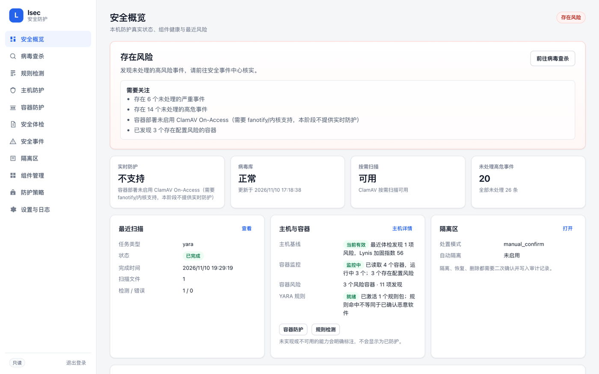
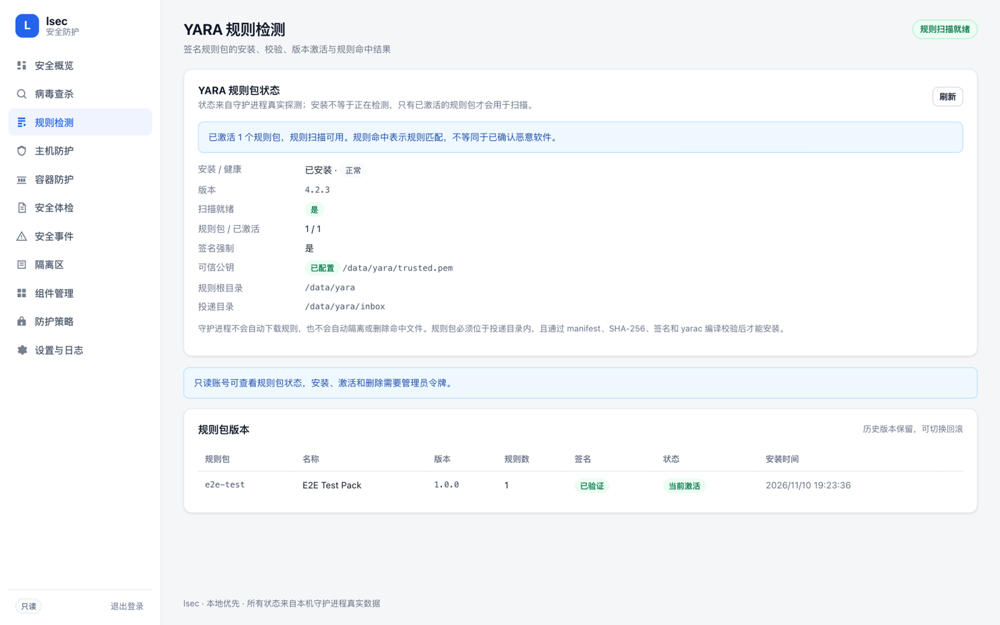
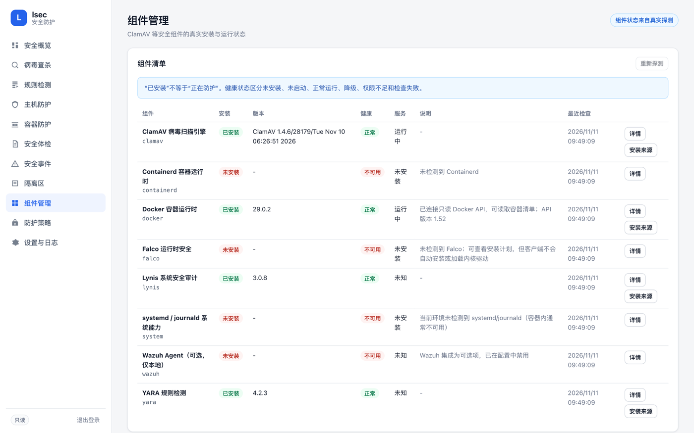

# lsec · Linux 统一安全防护客户端

lsec 是一个本地优先的 Linux 主机安全客户端：单实例守护进程统一管理 ClamAV、YARA、Lynis、Falco 与可选的本机 Wazuh Agent 接入，提供 Web 管理界面和 CLI。所有状态、扫描结果与风险结论都来自本机真实探测和真实任务执行。

<p align="center">
  
</p>

> 截图来自测试部署，其中包含专门用于验证容器风险检查的高危容器，因此总状态如实显示“存在风险”。lsec 不会把未安装、未启用或无法验证的能力显示为“已防护”。

## 主要能力

- 单实例守护进程（文件锁），SQLite + WAL，事务化迁移与迁移前备份
- HTTP JSON API + 原生 Web UI（无前端框架、无外部 CDN）
- CLI（`lsec`）：状态、组件、扫描、任务、事件、隔离区、审计、自检、导出
- 管理员 / 只读两种角色；Web 使用 HttpOnly + SameSite=Strict 会话 Cookie，写操作要求 CSRF 头
- 统一组件探测：ClamAV、Lynis、Falco、YARA、Wazuh、Docker、systemd 的真实安装、运行与健康状态
- ClamAV：clamd 探测/启动/停止、病毒库状态、freshclam 更新、快速/全盘/自定义扫描
- 扫描任务：队列、并发限制、真实进度、取消、重启后中断任务标记失败、证据报告
- 统一事件中心：ClamAV/YARA/Falco/Wazuh/Lynis 事件归一化、确定性严重程度映射、去重合并并保留全部来源证据、过滤、状态流转、JSON/CSV 导出
- 隔离区：手动确认、哈希校验、符号链接/越界路径拒绝、恢复/删除二次确认、审计留痕
- 主机安全体检（只读）：账户/UID、空密码、重复 UID、敏感文件权限、SSH 基线、危险监听端口、传统服务、ASLR、AppArmor/SELinux
- Lynis 集成：只读审计、加固指数、warning 归一化为统一事件、suggestion 保留在证据报告
- 容器清单：通过独立只读 Docker API 代理读取；Web 进程默认不挂载 Docker Socket
- 容器危险配置检查：特权模式、host 网络/PID/IPC、Docker Socket 挂载、敏感目录挂载、过宽 capabilities、seccomp/AppArmor/SELinux、设备直通；缺少详情字段时显示“未能评估”，不当作安全
- Falco 接入：内核/eBPF 能力探测，区分兼容、不支持、权限不足与需配置；只读安装计划、独立令牌事件接入；未验证运行绝不显示“已防护”
- YARA：签名规则包安装/校验/版本激活/删除，`yarac` 编译校验，只读枚举与规则扫描，命中写入统一事件；不会自动下载规则
- Wazuh（可选）：只读探测本地 Agent、Manager 配置与注册信息是否存在；可选从本地 `alerts.json` 读取新增行并归一化；明确不是 Wazuh Manager，不联系 Manager、不管理其他 Agent
- 更新签名校验：`freshclam` 更新后用 `sigtool --info` 复核 CVD 数字签名，结果写入更新响应与审计；未验证从不显示为已验证
- 发布工程：deb 包（systemd 加固单元、安装/升级/卸载脚本）、源码包、SHA256SUMS 与可选 GPG 分离签名
- Containerd：仅探测二进制与 Socket，明确不提供清单，不会冒充 Docker 清单
- 结构化日志、运行环境自检（`lsec doctor`）、操作审计
- Docker Compose 部署；默认只发布到宿主机回环地址；容器监控使用独立 GET-only 代理覆盖文件

## 界面预览

| YARA 规则检测 | 组件状态 |
| --- | --- |
|  |  |

## 明确不支持的能力

| 能力 | 状态 | 说明 |
| --- | --- | --- |
| Containerd 容器清单 | 不支持 | 仅探测二进制与 Socket；清单只来自所连接的 Docker 运行时 |
| Falco 自动安装/启动 | 不支持 | 只提供能力探测与只读安装计划，不安装、不加载驱动、不启动 Falco |
| Wazuh Manager 能力 | 不支持 | 只接入本地 Agent 状态与本地告警；不提供 Manager API、集群管理或其他 Agent 管理 |
| YARA 规则自动下载 | 不支持 | 规则包必须由管理员投放并校验签名后手动安装/激活 |
| 自动处置 | 不支持 | 不自动删除、不自动隔离、不杀进程、不停止/重启/修改容器 |
| ClamAV 实时防护 | 不支持 | 容器内未启用 fanotify/On-Access；界面显示 `unsupported` |

## 快速开始（Docker）

```bash
# 1. 准备可扫描目录（示例）
mkdir -p scan-data

# 2. 构建并启动（首次会下载 ClamAV 病毒库，可能需要数分钟）
docker compose build
docker compose up -d
docker compose logs -f lsec

# 3. 读取自动生成的管理员令牌（不要粘贴到聊天或工单）
docker compose exec -T lsec cat /data/secrets/admin.token
```

浏览器访问 `http://127.0.0.1:8080/`（默认只绑定宿主机回环）。输入管理员令牌登录。

### 启用容器监控（可选）

基础部署默认**不**挂载 Docker Socket，容器页面会如实显示“未启用”。需要容器清单与危险配置检查时，使用覆盖文件启动一个只读代理：

```bash
docker compose -f docker-compose.yml -f docker-compose.container.yml up -d --build
```

这会增加 `lsec-docker-proxy` 服务：它挂载 `/var/run/docker.sock:ro`，但只转发 `GET /version`、`GET /info`、`GET /containers/json`、`GET /containers/<id>/json`，拒绝所有启动/停止/删除等写操作，并运行在 `internal: true` 的私有网络上。lsec 本身仍不挂载 Docker Socket。

> Docker Socket 本质上等同宿主机高权限。代理容器因此会被容器检查标记为“严重”（挂载了 docker.sock）——这是真实风险提示，不是误报。请把代理视为受信任的高权限组件，不要把它暴露到宿主机端口或其他网络。

远程浏览器建议使用 SSH 隧道：

```bash
ssh -L 8080:127.0.0.1:8080 <user>@<server>
# 然后本地打开 http://127.0.0.1:8080/
```

如果必须在可信局域网直接访问，显式设置：

```bash
LSEC_LISTEN_ADDR=0.0.0.0 LSEC_PORT=8080 docker compose up -d
```

> 未启用 TLS 时，令牌会以明文 HTTP 传输。生产环境请使用 TLS 反向代理或在 `lsec.toml` 中配置 `server.tls_cert/tls_key`。

## 扫描 EICAR 测试文件

EICAR 是行业标准的防病毒测试样本，不含恶意代码。

```bash
./scripts/seed-eicar.sh ./scan-data
# Web: 病毒查杀 → 快速扫描
# 或 CLI:
docker compose exec -T lsec lsec scan quick --wait
docker compose exec -T lsec lsec events list
```

预期结果：

- 任务状态 `已完成`，检测数 1，事件级别 `中危`
- 事件来源 `clamav`、类别 `malware`、检测名为 ClamAV 实际返回值（1.4.x 为 `Eicar-Signature`，旧版本可能为 `Eicar-Test-Signature`）
- 可在事件详情或扫描详情中手动隔离；隔离、恢复、删除均需确认并写入审计

也可以运行自动化 E2E 脚本：

```bash
./scripts/e2e-eicar.sh
```

## CLI 示例

容器内：

```bash
docker compose exec -T lsec lsec status
docker compose exec -T lsec lsec components list
docker compose exec -T lsec lsec doctor
docker compose exec -T lsec lsec scan quick --wait
docker compose exec -T lsec lsec task list
docker compose exec -T lsec lsec events list --severity medium
docker compose exec -T lsec lsec events export --format csv --output /data/events.csv
docker compose exec -T lsec lsec quarantine list
docker compose exec -T lsec lsec quarantine add --path /scan/eicar.txt --confirm
docker compose exec -T lsec lsec quarantine restore <item_id> --confirm
docker compose exec -T lsec lsec audit list              # 操作审计记录
docker compose exec -T lsec lsec audit run --wait        # 运行只读主机体检
docker compose exec -T lsec lsec audit report            # 最近一次体检报告
docker compose exec -T lsec lsec audit history           # 体检历史
docker compose exec -T lsec lsec containers list         # 容器清单与风险
docker compose exec -T lsec lsec containers inspect <id> # 单个容器风险详情
docker compose exec -T lsec lsec containers refresh      # 管理员手动刷新（只读）
docker compose exec -T lsec lsec falco status            # Falco 能力与事件接入
docker compose exec -T lsec lsec falco install-plan      # 只读安装计划
docker compose exec -T lsec lsec yara status             # YARA 与规则包状态
docker compose exec -T lsec lsec yara packs              # 规则包版本与激活状态
docker compose exec -T lsec lsec scan path /scan/sample --engine clamav --engine yara --wait
docker compose exec -T lsec lsec wazuh status            # 本地 Wazuh Agent 状态（可选）
docker compose exec -T lsec lsec wazuh install-plan      # 只读安装计划
```

> `--engine` 可重复，当前支持 `clamav` 与 `yara`；只有两种引擎都失败时任务才标记为失败，单引擎失败会标记为部分完成并保留错误。

## 安装 deb 包（宿主机部署）

```bash
# 在 Debian/Ubuntu 构建机上生成发布物
scripts/build-release.sh

# 校验并安装
sha256sum -c dist/SHA256SUMS
sudo apt install ./dist/lsec_0.4.0_all.deb
sudo systemctl status lsec
sudo cat /var/lib/lsec/secrets/admin.token      # 管理员令牌，请勿粘贴到聊天或工单
```

默认监听 `127.0.0.1:8080`，可通过 SSH 隧道访问。升级、卸载、回滚与签名校验见 [部署与运维](docs/DEPLOYMENT.md) 和 [发布说明](docs/RELEASE.md)。

宿主机上直接使用 CLI：

```bash
PYTHONPATH=src python3 -m lsec.cli --server http://127.0.0.1:8080 --token "$(cat token)" status
```

`lsec` 依次从 `--token`、`LSEC_TOKEN`、`--token-file`、`/data/secrets/admin.token`、`~/.config/lsec/token` 读取令牌。

## 测试

```bash
./scripts/test.sh
```

覆盖：

- 配置严格校验与环境变量覆盖
- 路径穿越、符号链接、越界路径拒绝
- 事件严重程度映射、去重合并、状态机
- 扫描任务状态机与重启恢复
- 真实 HTTP 服务的认证、角色、CSRF、Origin 校验、安全响应头
- 使用假 clamd UNIX Socket（仅测试替身）完成扫描 → 事件 → 隔离 → 恢复 → 删除的完整链路
- 设置校验、未支持能力拒绝、doctor 自检
- 主机检查：固定根文件系统中的 UID 0、空密码、重复 UID、权限、SSH、端口、ASLR、缺失文件与执行失败分离
- Lynis 报告解析（真实 3.0.8 格式）、只读调用参数、报告/日志 0600 权限
- 体检 API：管理员发起、只读用户 403、后台完成、证据写入、主机基线状态与 `audit.run` 记录
- YARA 签名、哈希、编译校验、版本管理与扫描去重
- Wazuh 告警文件接入的偏移、轮转、截断与边界处理

当前完整测试为 `160 tests OK`；真实 Linux + ClamAV/YARA 的 E2E 验证见 [测试说明](docs/TESTING.md) 与 [安全/性能测试报告](docs/TEST-REPORT.md)。EICAR 验证脚本见 `scripts/e2e-eicar.sh`。

## 目录结构

```text
src/lsec/
  common/      配置、错误、命令执行、日志、路径校验、主机信息
  storage/     SQLite 迁移与各仓储
  adapters/    Adapter 契约、ClamAV、Lynis、Falco、YARA、Wazuh、探测型组件适配器
  core/        扫描、主机检查与体检、容器检查、统一事件、YARA 规则包、Wazuh 接入、隔离、状态、自检、更新、维护
  api/         认证、HTTP 路由与 Web 静态资源
  web/         index.html / style.css / app.js
  daemon.py    守护进程入口
  cli/         lsec CLI
packaging/     Dockerfile、只读 Docker 代理、容器配置、入口脚本、debian/ 打包元数据
tests/         单元测试、集成测试
docs/          架构、API、安全、部署、发布、测试说明与测试报告
scripts/       测试、EICAR、E2E、发布构建/校验脚本
```

## 关键设计约束

- 不使用 shell 字符串执行外部命令；所有子进程使用 argv 列表
- 不伪造扫描结果、组件状态或防护状态；“已安装”不等于“正在防护”
- 不自动删除/隔离；高危操作必须显式确认并审计
- 令牌、会话、CSRF 值不写入日志
- 隔离与恢复校验哈希、拒绝符号链接、限制在允许目录内
- 单节点部署，不提供中心管理端

更多细节：

- [架构设计](docs/ARCHITECTURE.md)
- [HTTP API](docs/API.md)
- [安全模型](docs/SECURITY.md)
- [安全策略与漏洞报告](SECURITY.md)
- [部署与运维](docs/DEPLOYMENT.md)
- [发布说明](docs/RELEASE.md)
- [测试说明](docs/TESTING.md)
- [安全/性能测试报告](docs/TEST-REPORT.md)

## 已知限制

- 容器部署未提供 ClamAV 实时防护；总状态会显示“防护不完整”
- 容器内进程以 root 运行以读取挂载的扫描目录；未挂载 Docker Socket
- 默认仅监听宿主机回环地址；局域网直连需要显式开启且建议配合 TLS
- 全盘扫描以容器可见文件系统为根，不包含未挂载的宿主机路径
- 恢复隔离文件时以 0600、容器内 root 写回，不保留原文件权限与属主
- 主机体检范围是容器可见的文件系统、网络命名空间与内核参数；未挂载的宿主机路径和宿主网络不在范围内
- 体检只读，不会修复发现的问题；Lynis warning 的严重程度由固定关键词规则映射，不是漏洞评分
- 容器清单只覆盖代理所连接的 Docker 运行时；Containerd 仅探测，不采集清单
- 容器配置检查是启发式规则，不等同于漏洞/镜像扫描或运行时行为检测；缺少详情字段的容器显示为“未能评估”
- 启用容器监控后，代理容器因挂载 Docker Socket 会被标记为严重风险；这是真实风险，不应忽略
- Falco 未自动安装或启动；`compatible` 只表示环境前提具备，`running_verified` 始终为 false，需宿主侧确认
- YARA 规则扫描是规则匹配，不是完整恶意软件判定；规则质量与签名信任完全取决于管理员投放的规则包
- Wazuh 只读取本地 Agent 与本地 `alerts.json`；Manager 连接状态无法从本客户端验证，界面始终显示“未验证”
- `sigtool` 只能复核 `.cvd` 的 CVD 数字签名；`.cld` 目录格式没有 CVD 签名，会显示“未验证/不适用”
- deb 包默认启动服务但不含 ClamAV/YARA/Lynis 二进制（Recommends）；首次扫描前需安装并等待病毒库下载

## 许可证

[MIT](LICENSE)
